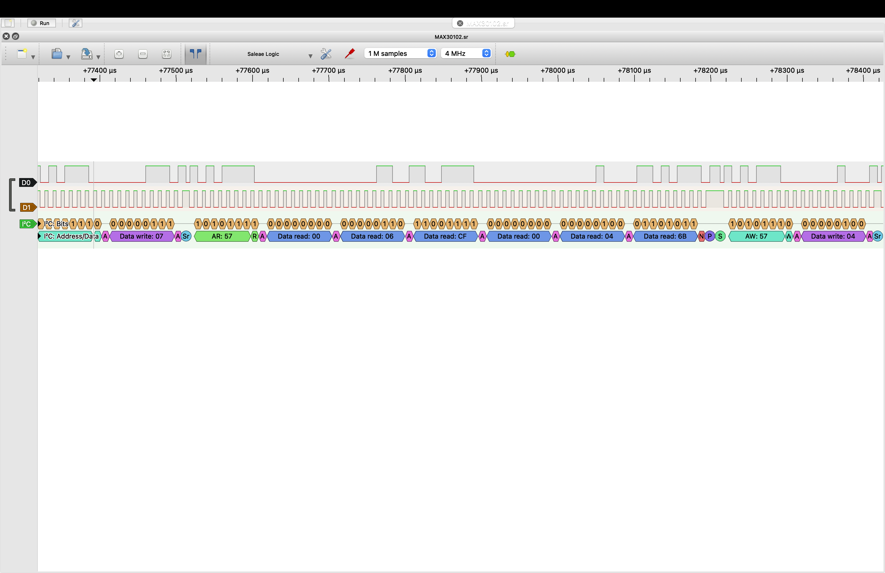

# MAX30102 I²C Hardware Validation

## Objective

Validate I²C communication between the Raspberry Pi Pico 2 and MAX30102 sensor using a SparkFun USB logic analyzer.

This experiment independently examines the electrical communication generated by the C++ MAX30102 driver.

## Equipment

- Raspberry Pi Pico 2
- MAX30102 optical sensor
- SparkFun USB Logic Analyzer, 24 MHz / 8-Channel (TOL-18627)
- MacBook Air (Apple M2)
- PulseView software

## Test Configuration

| Parameter | Value |
|---|---|
| I²C address | 0x57 |
| SDA | GP4 |
| SCL | GP5 |
| Configured I²C frequency | 100 kHz |
| Logic analyzer sample rate | 4 MHz |
| Sample count | 1 million |
| Capture duration | 250 ms |

## Test 1: I²C Clock Frequency

The logic analyzer measured an SCL clock period of **10.48 µs**.

Calculated frequency:

**f = 1 / (10.48 × 10⁻⁶) = 95.42 kHz**

The measured frequency was approximately 4.6% below the configured frequency of 100 kHz.

**Observation:** I²C clock activity was detected near the configured frequency. Further measurements would be required to characterize clock timing and determine the cause of the difference.

## Test 2: FIFO Pointer Registers

PulseView decoded the following register reads:

| Register | Address | Returned value |
|---|---|---|
| FIFO_WR_PTR | 0x04 | 0x0A |
| FIFO_RD_PTR | 0x06 | 0x0A |

Both pointers returned decimal 10.

The driver computes unread samples using:

`count = (wr - rd) & 0x1F`

For these observed values, the calculation produces zero. However, the measurements were not necessarily simultaneous, and equal FIFO pointers alone do not establish whether the buffer is empty or full.

**Observation:** The driver successfully accessed both FIFO pointer registers.

## Test 3: FIFO Data Read

A transaction targeting register `0x07` (FIFO_DATA) returned six bytes:

`00 06 CF 00 04 6B`

The MAX30102 represents each red and infrared measurement using three bytes, with 18 significant bits.

| Channel | Raw bytes | Decoded value |
|---|---|---|
| Red | 00 06 CF | 1743 |
| Infrared | 00 04 6B | 1131 |

The data was decoded using bit shifts and an 18-bit mask, consistent with the C++ driver's sample reconstruction algorithm.

**Observation:** The six-byte FIFO transaction was successfully captured and decoded.

## Conclusion

The SparkFun logic analyzer confirmed I²C communication between the Raspberry Pi Pico 2 and MAX30102 at address `0x57`.

The observed register accesses and FIFO data format were consistent with the expected behavior of the MAX30102 C++ driver.

These measurements complement the project's host-side unit tests and physical sensor operation. They do not establish physiological accuracy or comprehensive electrical timing compliance.

## Evidence

- [PulseView session](max30102-i2c.pvs)
- [Raw I2C capture](max30102-i2c.sr)

